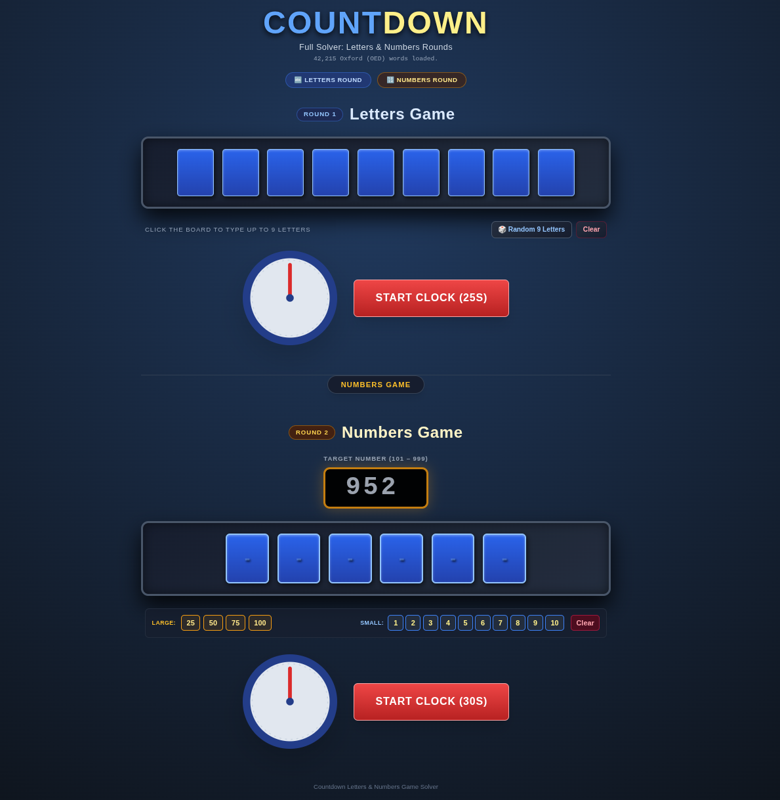

# countdown-solver

An interactive web-based solver for the classic Channel 4 TV game show ***Countdown***, featuring both the **Letters Round** and the **Numbers Round** with authentic studio visuals and animated countdown clocks.



---

## Features

### 🔤 Letters Round
- **Classic 9-Tile Board:** Blue-and-gold tiles with click-to-type input and auto-capitalization.
- **Oxford English Dictionary (OED):** Powered by an offline database of over 42,000 words extracted from the Oxford English Dictionary.
- **Iconic Countdown Clock:** 25-second animated clock with golden sweeping sector and rotating hand.
- **Dictionary Corner Breakdown:** Results grouped by word length (from 9-letter words down to 3-letter words), sorted alphabetically.
- **Random Letter Generator:** Draws 4 vowels and 5 consonants adhering to official Countdown letter frequencies.

### 🔢 Numbers Round
- **Digital Target Display:** 3-digit retro LED target display (101–999).
- **6-Tile Numbers Board:** Supports direct typing, auto-advancing, and keyboard navigation.
- **Number Chips Tray:** Quick-tap chips for Large numbers (`25`, `50`, `75`, `100`) and Small numbers (`1` through `10`).
- **High-Speed BFS Solver:** Ultra-fast Breadth-First Search algorithm that guarantees the shortest sequence of arithmetic operations (`+`, `-`, `×`, `÷`) in under 100ms.
- **Rachel's Board:** Step-by-step mathematical breakdown showing every intermediate calculation.
- **Alternative Solutions:** View multiple alternative ways to reach the exact target when available.
- **30-Second Clock:** Dedicated Countdown timer with sweeping visual animation.

---

## Getting Started

### Prerequisites
- Python 3 (or any static HTTP server)
- Modern web browser (Chrome, Firefox, Edge, Safari)

### Running Locally
1. Clone the repository:
   ```bash
   git clone https://github.com/Frankmau5/countdown-solver.git
   cd countdown-solver
   ```

2. Start a local HTTP server:
   ```bash
   python3 -m http.server 8000
   ```

3. Open your browser and navigate to:
   ```
   http://localhost:8000/
   ```

---

## Project Structure
- `index.html` — Single-page application containing the HTML, Tailwind CSS, SVG clocks, and solving algorithms.
- `words.txt` — Curated dictionary of 42,215 words (3–9 letters) from the Oxford English Dictionary.
- `README.md` — Project documentation.
